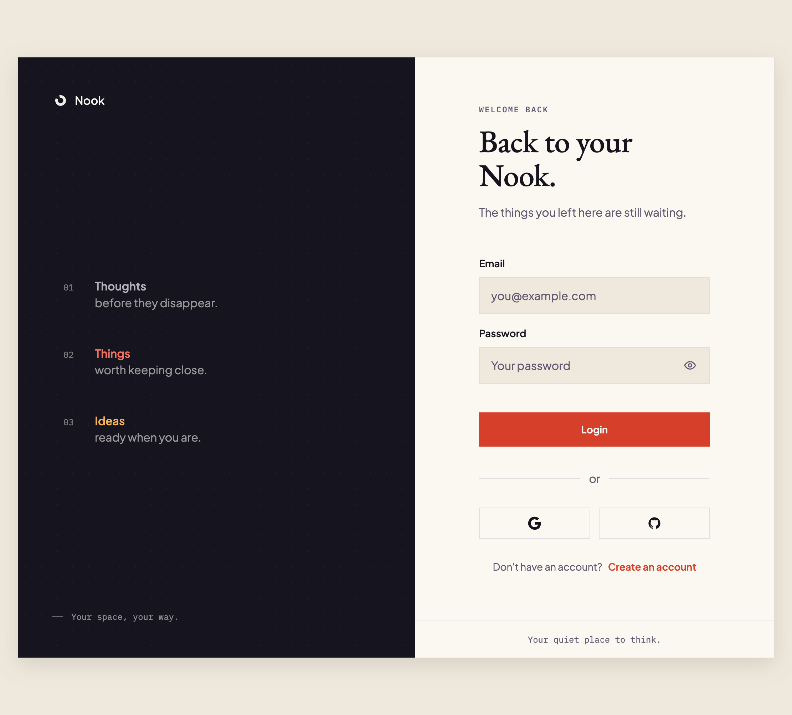
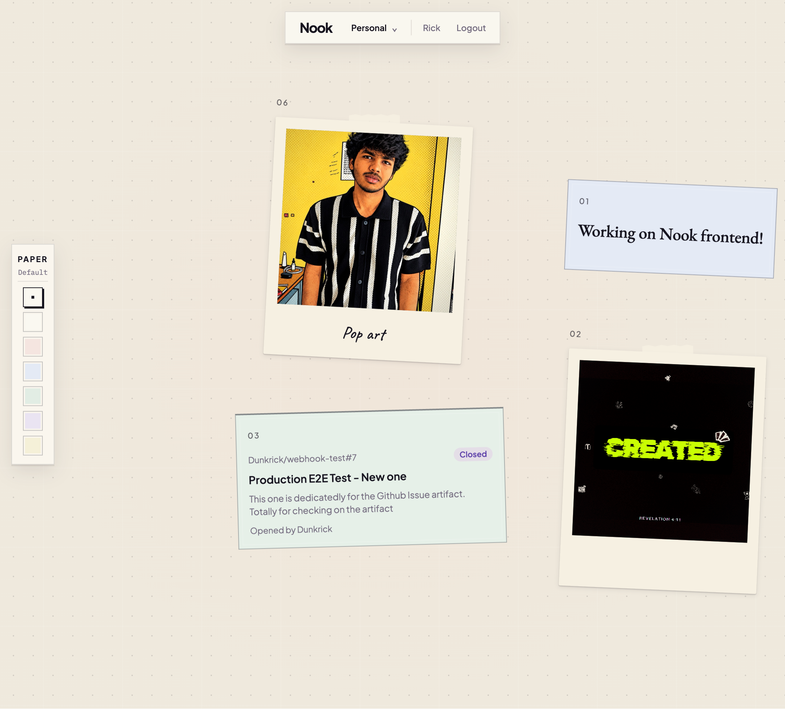

# Nook

> A spatial workspace for capturing thoughts, connecting ideas, and making sense of what matters.

Nook is a full-stack thinking workspace built around a simple idea:

**Thinking should feel spatial before it feels structured.**

Instead of forcing ideas into folders, documents, or rigid workflows, Nook lets users place thoughts directly onto a workspace and interact with them naturally.

**Capture first. Connect naturally. Find clarity next.**

---

## Interface





---

## Current capabilities

### Authentication

- User registration and login
- Google and GitHub OAuth 2.0 authentication with account linking
- JWT-based authentication
- Protected application routes
- Private user workspaces
- Password visibility control

### Spatial workspace

- Workspace-based artifact model
- Text, link, Polaroid (with captions), and GitHub Issue artifacts
- Type-specific paper stocks (`--stock-text`, `--stock-link`, `--stock-photo`, `--stock-issue`)
- User-selectable paper tint customization palette with accessible swatches
- Physical micro-interactions: lift on hover, hold on drag, and tactile settle on drop
- Distinct typographic voices (serif for thoughts, mono for metadata, handwriting for polaroid captions)
- Free positioning with persisted `x` / `y` coordinates
- Draft artifact creation
- Drag and reposition artifacts
- Inline text and caption editing
- Artifact deletion
- Multi-artifact selection and selection toolbar
- Ask your workspace: grounded answers with key points, evidence links, and open issue follow-ups

### Media

- Multipart image uploads through the Nook API
- Private AWS S3 bucket (or local storage fallback)
- Per-user object keys
- JPEG, PNG, and WebP validation
- 10 MB upload limit
- Short-lived signed read URLs for private Polaroid images

### Engineering

- Layered backend architecture: routes → services → Prisma/storage
- Typed artifact domain model
- Pluggable `ObjectStorage` abstraction (AWS S3 & LocalStorage)
- Backend unit tests with Vitest
- Frontend component tests with Vitest
- Backend tests, type checking, and production builds in CI
- Dockerized backend
- AWS EC2 / Docker deployment through GitHub Actions

---

## Architecture

```text
Browser
  │
  ├── React + TypeScript + Vite
  │     ├── pages
  │     ├── components
  │     ├── hooks
  │     └── services
  │
  │ HTTP / JSON + multipart
  ▼
Express + TypeScript
  │
  ├── authentication / validation
  ├── routes
  ├── services
  └── storage abstraction
       ├── Prisma
       └── AWS S3 / LocalStorage
              │
              └── private media + signed reads
  │
  ▼
PostgreSQL / Neon
```

The browser never receives direct public access to private media buckets. A Polaroid image is stored as an `imageKey` in artifact JSON, and the authenticated API verifies ownership before issuing a short-lived signed read URL (or local static URL).

See [`docs/architecture.md`](./docs/architecture.md) for request flows and layer responsibilities.

---

## GitHub Integration

Nook can synchronize GitHub issues into spatial workspace artifacts.

```text
GitHub
  ↓
Webhook
  ↓
RabbitMQ
  ↓
Background Worker
  ↓
PostgreSQL
  ↓
Nook Artifact
```

The integration includes:

- HMAC-SHA256 webhook verification
- asynchronous RabbitMQ processing
- retry queues and dead-letter handling
- webhook delivery idempotency
- transactional persistence
- GitHub issue → Nook artifact upserts
- production deployment via Docker Compose on AWS EC2
- independent GitHub worker runtime

Supported issue lifecycle:
`opened` → `edited` → `closed` → `reopened`

See [GitHub Integration](docs/integrations/github.md) for the implementation details.

---

## Artifact model

Nook currently represents four artifact types:

| Type           | Meaning                    | Stored content                                                 |
| -------------- | -------------------------- | -------------------------------------------------------------- |
| `TEXT`         | “I thought this”           | `{ text }`                                                     |
| `LINK`         | “I found this”             | `{ url }`                                                      |
| `POLAROID`     | “I saw / experienced this” | `{ imageKey, caption? }`                                       |
| `GITHUB_ISSUE` | “I am tracking this”       | `{ repository, issueNumber, title, body, state, url, author }` |

Spatial state and customization are stored independently from artifact content:

- `x`
- `y`
- `zIndex`
- `tint` (custom paper tint override)
- `createdAt`
- `updatedAt`

The database schema lives in `backend/prisma/schema.prisma`.

---

## API surface

### Auth

- `POST /auth/register`
- `POST /auth/login`
- `GET /auth/google`
- `GET /auth/google/callback`
- `GET /auth/github`
- `GET /auth/github/callback`

### Workspaces

- `GET /workspaces`
- `GET /workspaces/:id`
- `POST /workspaces`
- `GET /workspaces/:workspaceId/artifacts`
- `POST /workspaces/:workspaceId/artifacts`
- `PATCH /workspaces/:workspaceId/artifacts/:id`
- `DELETE /workspaces/:workspaceId/artifacts/:id`
- `POST /workspaces/:workspaceId/ask`

### Ask your workspace

Ask lets an authenticated user ask a question about saved workspace artifacts. The API checks workspace ownership, retrieves up to eight relevant artifacts, then sends only that selected evidence to Gemini. Gemini returns structured JSON; backend validates the response and removes citations to artifacts outside the retrieved set. Empty retrieval returns a fixed no-evidence answer without a model call. An optional tool-calling path lets the model choose search filters; backend still runs retrieval using authenticated user and workspace ids.

```text
Question → authenticate + ownership check → keyword retrieval and ranking
  → selected evidence → Gemini structured answer → validate + ground citations
  → answer, key points, evidence, unresolved open issues
```

Limits: retrieval is keyword-based and in-memory, not semantic search. It reads workspace artifacts before ranking, returns at most eight hits, and uses `createdAt` for recency. Image contents are not searchable; Polaroid captions are. The UI opens Ask from selected cards, but current endpoint searches the whole workspace rather than only selected cards. The manual ten-fixture evaluation uses synthetic evidence and the single-shot prompt; it does not exercise real retrieval or the tool-calling path. It checks format and citation boundaries, not answer truth or production accuracy.

**Resume-safe status:** Ask is built in this repository. Public API health responds and the Ask route requires authentication; authenticated generation and production `API_KEY` configuration are not verified, so do not describe Ask as live.

### Media

- `POST /uploads`
- `GET /artifacts/:id/image`

The image endpoint returns JSON containing a signed URL rather than redirecting the browser to cloud storage.

### Webhooks

- `POST /webhooks/github`

### Health

- `GET /health`

---

## Tech stack

### Frontend

- React
- TypeScript
- Vite
- React Router
- CSS
- Semantic design tokens
- Vitest

### Backend

- Express
- TypeScript
- Prisma ORM
- PostgreSQL
- JWT authentication
- Multer
- AWS S3 client (`@aws-sdk/client-s3`)
- Local storage adapter
- Vitest

### Infrastructure

- Docker & Docker Compose
- AWS EC2 (Free Tier)
- AWS S3
- Neon PostgreSQL / AWS RDS
- RabbitMQ
- GitHub Actions

---

## Repository structure

```text
nook/
├── frontend/
│   ├── src/
│   │   ├── components/
│   │   ├── hooks/
│   │   ├── pages/
│   │   ├── services/
│   │   └── types/
│   ├── public/
│   └── package.json
│
├── backend/
│   ├── src/
│   │   ├── domain/
│   │   ├── middleware/
│   │   ├── routes/
│   │   ├── services/
│   │   ├── storage/
│   │   └── types/
│   ├── prisma/
│   ├── Dockerfile
│   └── package.json
│
├── docs/
│   ├── adr/
│   ├── design-system/
│   ├── brand/
│   ├── setup.md
│   └── deployment.md
│
├── CHANGELOG.md
├── package.json
└── README.md
```

---

## Local development

Requirements:

- Node.js 22+
- PostgreSQL or a Neon PostgreSQL database
- Git
- Docker Desktop is optional

See [`docs/setup.md`](./docs/setup.md).

```bash
npm install
npm run dev
```

Frontend: `http://localhost:5173`  
Backend: `http://localhost:3003`

---

## Testing and builds

Frontend:

```bash
cd frontend
npm test
npm run build
```

Backend:

```bash
cd backend
npm test
npm run typecheck
npm run build
```

The backend CI workflow also builds the Docker image.

---

## Production

The backend is containerized and deployed to AWS EC2 using Docker Compose. GitHub Actions runs on pushes to `main`, deploys database migrations, and updates the running containers on EC2.

See [`docs/aws-setup.md`](./docs/aws-setup.md) and [`docs/deployment.md`](./docs/deployment.md).

---

Off Campus code: FM3SZH

---

## Project status

Nook is an actively evolving project. Ask your workspace is built as an authenticated, evidence-grounded workspace question feature; production answer generation has not been verified.
